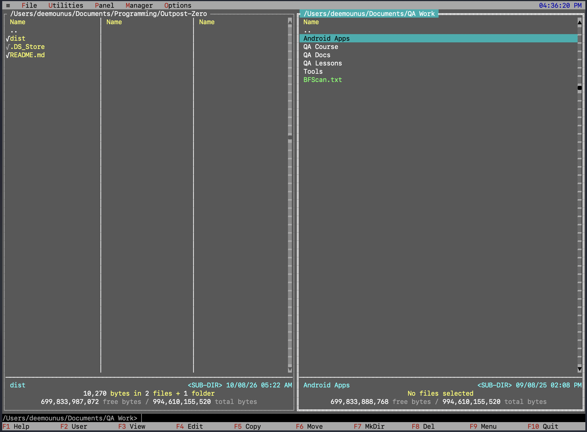
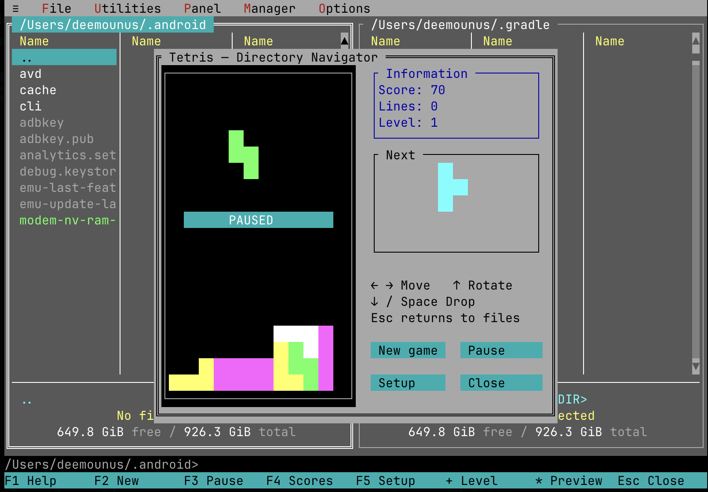
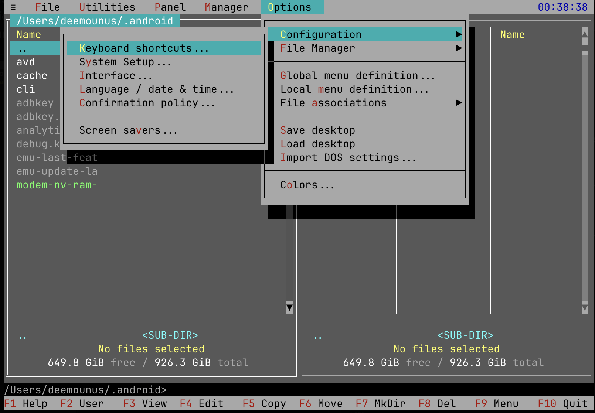
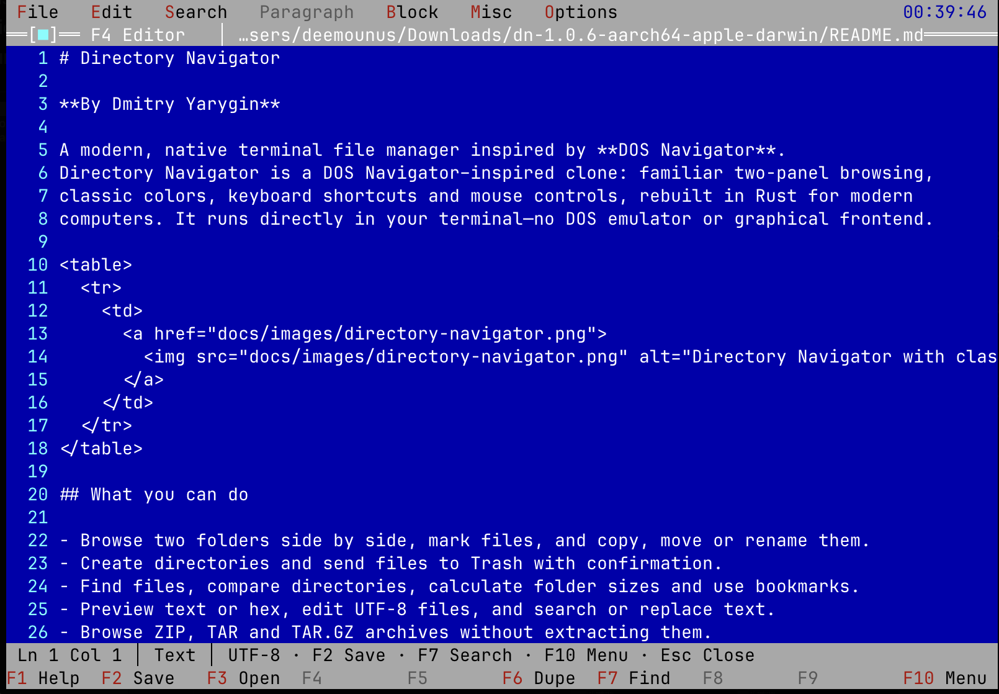
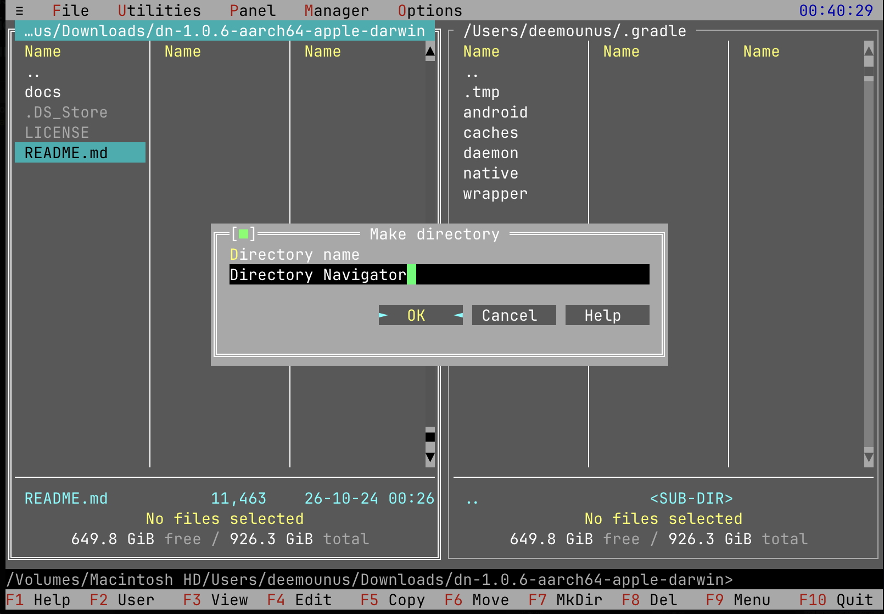

# Directory Navigator

**By Dmitry Yarygin**

A modern, native terminal file manager inspired by **DOS Navigator**.
Directory Navigator is a DOS Navigator–inspired clone: familiar two-panel browsing,
classic colors, keyboard shortcuts and mouse controls, rebuilt in Rust for modern
computers. It runs directly in your terminal—no DOS emulator or graphical frontend.

<table>
  <tr>
    <td>
      <a href="docs/images/directory-navigator.png">
        
      </a>
    </td>
  </tr>
</table>

## What you can do

- Browse two folders side by side, mark files, and copy, move or rename them.
- Create directories and send files to Trash with confirmation.
- Find files, compare directories, calculate folder sizes and use bookmarks.
- Preview text or hex, edit UTF-8 files, and search or replace text.
- Browse ZIP, TAR and TAR.GZ archives without extracting them.
- Type shell commands directly into the bottom command prompt.
- Customize the layout, colors, clock and screensaver; settings save on exit.
- Configure file extensions to use DN's viewer/editor or your preferred commands.
- Classic panel footers show selection totals and available/total volume space.
- Choose English or Russian, with independent date order and 12/24-hour time.
- Recall commands through a searchable session history; copy filenames or paths to the internal clipboard.
- Use the calculator, character table and configurable user menus—or play Tetris with named, persistent high scores.

## In action

<table>
  <tr>
    <td align="center" width="50%" valign="top">
      <a href="docs/images/tetris.png">
        
      </a>
      <br><strong>Tetris</strong><br>A classic break, with saved high scores.
    </td>
    <td align="center" width="50%" valign="top">
      <a href="docs/images/options.png">
        
      </a>
      <br><strong>Make it yours</strong><br>Configure shortcuts, appearance and regional formats.
    </td>
  </tr>
  <tr>
    <td align="center" width="50%" valign="top">
      <a href="docs/images/editor.png">
        
      </a>
      <br><strong>Built-in editor</strong><br>Edit UTF-8 text without leaving the terminal.
    </td>
    <td align="center" width="50%" valign="top">
      <a href="docs/images/make-directory.png">
        
      </a>
      <br><strong>Everyday file tasks</strong><br>Create folders through compact, familiar dialogs.
    </td>
  </tr>
</table>

## Get started

### Run a supplied binary

On macOS or Linux, open a terminal in the folder containing a compatible `dn`:

```sh
chmod +x dn
./dn
```

Use `dn --version` (or `dn -V`) to check the installed version.

It starts in your current directory. Use a terminal at least **80 columns × 25 rows**.
The current macOS build is for **Apple Silicon** and is not Developer ID signed or
notarized, so macOS may block downloaded copies. Test builds need no Rust installation.

### Build from source

With the stable Rust toolchain installed:

```sh
cargo build --release
./target/release/dn
```

On Windows, the executable is `target\release\dn.exe`.

| Platform | Current status |
| --- | --- |
| macOS Apple Silicon | Primary development and tested platform |
| Linux x86_64 / ARM64 | Targeted; runtime validation still pending |
| Windows 10/11 | Best effort; runtime validation still pending |

## Everyday controls

New installations open a short welcome with keyboard guidance, Help and keyboard
settings. Reopen it any time through **≡ → Welcome…**. Existing settings skip it.

**Classic DN shortcuts are the default on every platform**, including macOS.
Choose Classic DN, Mac-friendly or Automatic under **Options → Configuration →
Keyboard shortcuts**. Saved profile choices are preserved.

For Mac-friendly controls, press **Ctrl+O**, release, then a digit or letter. A guide
appears; **5** copies, **4** edits and **0** quits the file manager. **Ctrl+O, K** opens
keyboard settings. Classic keys remain available; `^O5` means Ctrl+O, then 5.
Automatic remains optional: it selects Mac-friendly on macOS and Classic DN elsewhere.

| Key | Action |
| --- | --- |
| Tab | Switch panels |
| Arrows / Page Up / Page Down | Navigate files |
| Enter / Backspace | Open the highlighted entry / go to its parent directory |
| Insert / Space | Mark or unmark an entry |
| F1 | Help |
| F2 | User menu |
| F3 / F4 | View / edit |
| F5 / F6 | Copy / move or rename |
| F7 / F8 | Create directory / Trash or delete with confirmation |
| F9 / F10 | Menu / exit |
| Ctrl+F7 / Alt+F7 | Recursive Find / quick filename search |
| Ctrl+Q / Ctrl+T | Quick view / directory tree |

Click to select, double-click to open, and Ctrl+click to mark. Inside the viewer
or editor, use F1 for that screen's controls. macOS may require Fn with function keys.

The bottom row is a command prompt. Type a command and press **Enter** to run it
in the active panel's directory; **Esc** clears it. **Ctrl+E / Ctrl+X** recall command
history. `cd "folder name"` changes the active panel's directory. With no command
entered, Enter opens the highlighted entry as usual. Shell commands run with your
normal permissions, independently of the file manager's confirmation safeguards.

## Settings and file handling

Preferences load automatically and save on normal exit. **Options → Save desktop**
saves immediately; **Options → Configuration → System Setup** controls saving on exit.

- macOS/Linux: `~/.config/dn/config.conf`, or `$XDG_CONFIG_HOME/dn/config.conf`.
- Windows: `%APPDATA%\DOSNavigator\config.conf`.

**Options → Configuration → Language / date & time** changes the interface language,
date order (year/month/day, day/month/year or month/day/year), date separator and
12/24-hour time with a configurable time separator. Apply accepts changes; Cancel
keeps the previous settings. The clock, panel dates and file information follow
these preferences. Defaults remain English, year-month-day and 24-hour time.
English and Russian catalogs are embedded, so the binary needs no companion files.
Untranslated diagnostics fall back to English; system errors retain their original text.

`config.conf` uses TOML with `config_version = 2` and grouped sections.
Only this format is supported; older flat files are not migrated. Invalid settings
are renamed to `_old_config.conf` (numbered if occupied), then defaults load.
Normal saving creates a fresh configuration; inaccessible/read-only files and
failed recovery still report errors.
Unknown TOML settings are retained. Only `config.conf` is loaded automatically;
`config.txt` is ignored.

**Options → Import DOS settings…** reads an original `DN.CFG` and previews supported
clock, hidden-file, sorting, highlighting, selection, editor and screensaver
preferences. Apply affects this session; normal saving persists it. Cancel changes
nothing, and the DOS file is never modified. DOS paths, desktop windows, commands,
hardware settings and custom palettes are excluded; Trash and confirmation safeguards
are retained. Compatibility is based on source-derived fixtures; a real user-supplied
`DN.CFG` has not yet been tested.

File operations refuse existing destinations. Trash is the default deletion mode;
a Trash failure never falls back to permanent deletion. Permanent deletion can be
selected in File Manager Setup and still requires confirmation.
Detected changes to queued entries or their parent directories stop the operation.
Cancellation or failure retains completed work; multi-file operations have no automatic rollback.

This is a **beta**. Archive browsing is read-only; the viewer is a bounded preview,
and the editor handles UTF-8 files up to 2 MiB / 100,000 lines. Test important
workflows on copies and report problems with your OS, terminal and reproduction steps.

For detailed shortcuts, limits and user-menu configuration, see the
[user guide](docs/USER_GUIDE.md).

### Original Tetris scores

To import an old DOS Navigator leaderboard, copy **`dn.tet`** (or `DN.TET`) beside
`config.conf`, then open/reopen Tetris. Its Tetris scores merge with modern scores
in `tetris.conf`, keeping the highest ten and avoiding repeated imports. The
original file stays untouched. Pentix scores are not imported.

DOS files do not identify their text encoding: the first import uses CP437 for
English or CP866 for Russian, according to the selected interface language. That
choice is remembered in the Tetris file. Unicode names remain supported for new
scores; unavailable original line counts display “—”.

## Development

```sh
cargo fmt --check
cargo clippy -- -D warnings
cargo test
cargo build --release
```

On GitHub, open **Actions → Build all platforms → Run workflow** to test and build
macOS (Apple Silicon and Intel), Linux (x86_64 and ARM64), and Windows (x86_64).
Each successful job uploads an archive containing the executable, README and MIT
license, plus a SHA-256 checksum. Downloads are under that run's **Artifacts** and
are retained for 30 days. These are unsigned builds; this workflow does not publish
a GitHub Release. **Rust checks** is also manual-only: open it in Actions and choose
**Run workflow**. Neither workflow runs on pushes, pull requests or a schedule.

### Unified draft releases

After pushing the workflow to the default branch, open **Actions → Build unified draft
release → Run workflow**, choose the source branch and enter a version **without
`v`**, for example `1.0.0` or `1.1.0-beta.1`.

The manual workflow checks, tests and builds all five targets: macOS Apple Silicon
and Intel, Windows x86_64, and Linux x86_64 and ARM64. It embeds your version in
the app, About and CLI, then creates an **unpublished draft release** tagged
`v<version>`. Prerelease versions are marked automatically.

Downloads are five versioned binary archives (four TAR.GZ files and a Windows ZIP),
each including the executable, README, user guide and MIT license. Checksum files
are used internally to verify the builds and are not attached to the release.

The tag points to the exact versioned source tree used for all builds. If needed,
a release-only commit updates Cargo.toml/Cargo.lock; your development branch is
not rewritten or bumped. Set the next branch version separately when appropriate.
Only the final job has repository write access, and no tag or draft is created
unless all five builds pass. Existing tags/releases are refused, never overwritten.
If publication fails after creating the tag or draft, inspect that version in GitHub;
finish the draft manually or deliberately remove the partial draft/tag before a new
run. The workflow does not delete or replace existing releases during recovery.

Review the draft, test the downloads, edit the release notes and publish it yourself.
macOS builds remain unsigned and unnotarized; Windows builds are unsigned. The
repository must permit Actions to write contents/create tags; restrictive tag rules can block the final job.
All workflows remain manual-only; nothing runs on pushes or tags.

### Separate Windows and Linux builds

These workflows remain independent of the unified draft release and run only when you
choose **Run workflow**. Select a source branch and enter the version without `v`.

| Actions workflow | Targets | Download under the run's Artifacts |
| --- | --- | --- |
| **Build Windows** | Windows x86_64 | **windows-downloads**: ZIP with `dn.exe` |
| **Build Linux** | Linux x86_64 and ARM64 | **linux-downloads**: two TAR.GZ archives with `dn` |

Both workflows check, test and build the app, verify the requested executable
version, and include the README, user guide, MIT license, individual SHA-256
checksums and `SHA256SUMS.txt`. Downloads are retained for 30 days. They create no
tags or GitHub releases and do not publish a draft. The selected version is
embedded in the binaries; the source branch is unchanged. Windows builds are
unsigned. A successful build does not replace testing in Windows Terminal or a
Linux terminal.

Release helper tests (Python 3.12+, standard library only):

```sh
python3 -m unittest discover -s scripts -p 'test_*.py'
```

The Rust application lives in `src/`, with tests in `tests/`.

## License

Directory Navigator is available under the [MIT license](LICENSE).

Copyright (c) 2026 Dmitry Yarygin.
