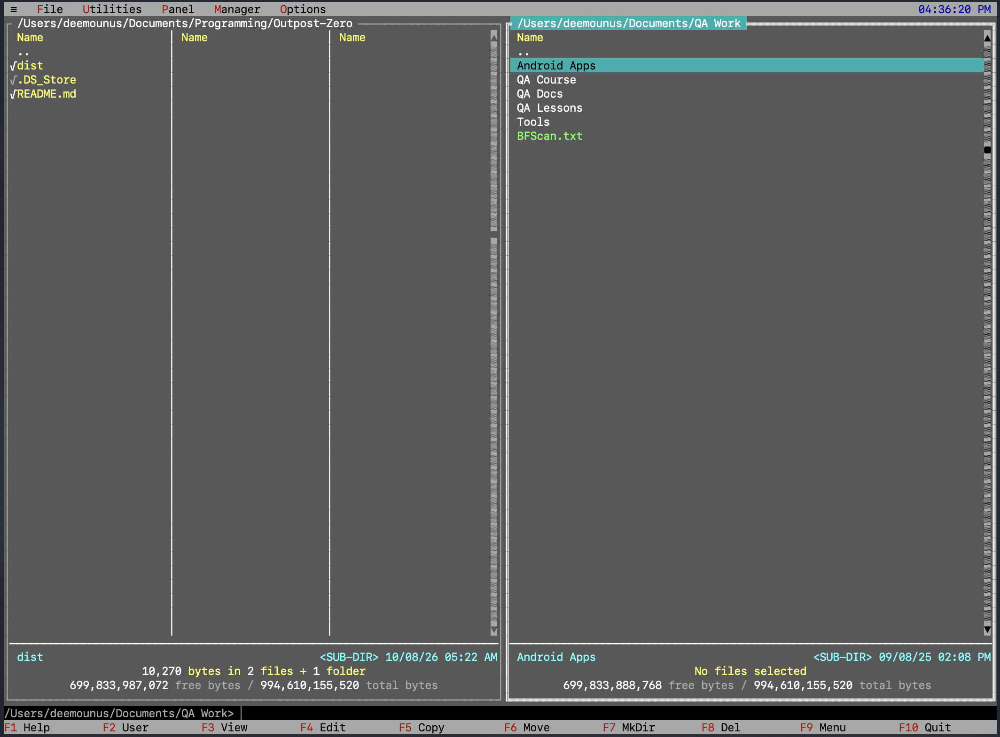
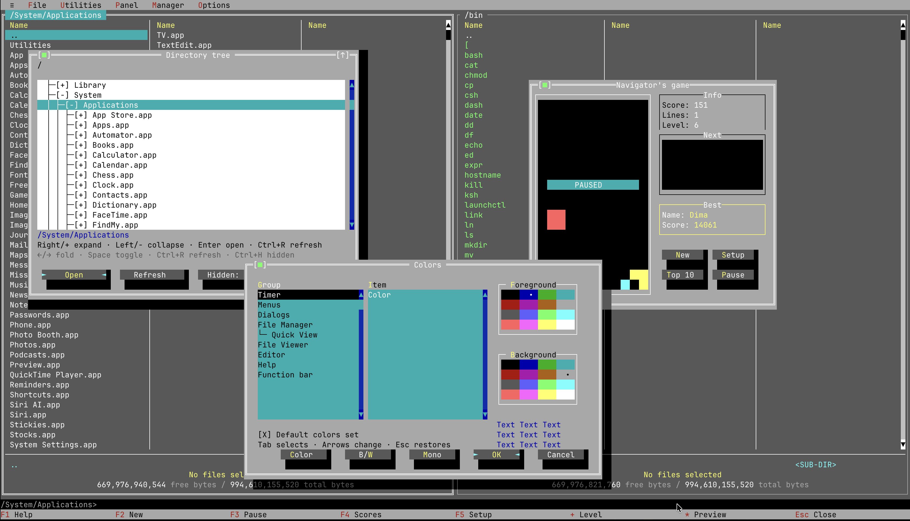
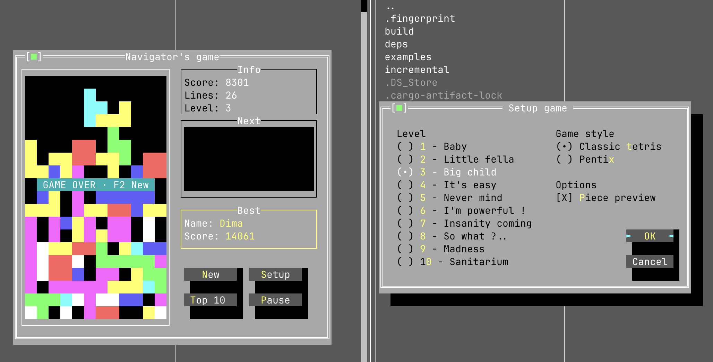
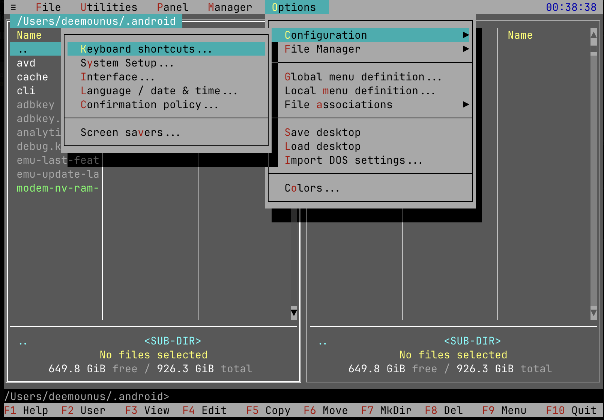
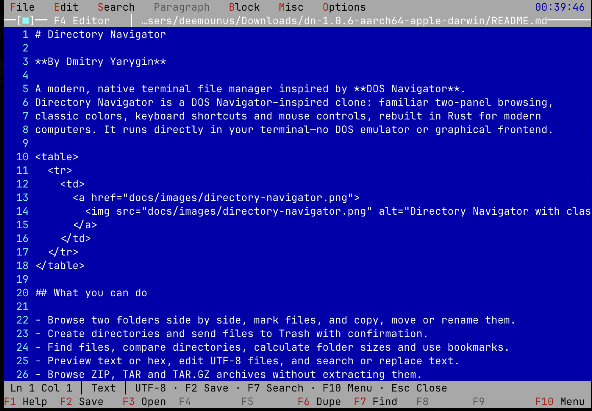
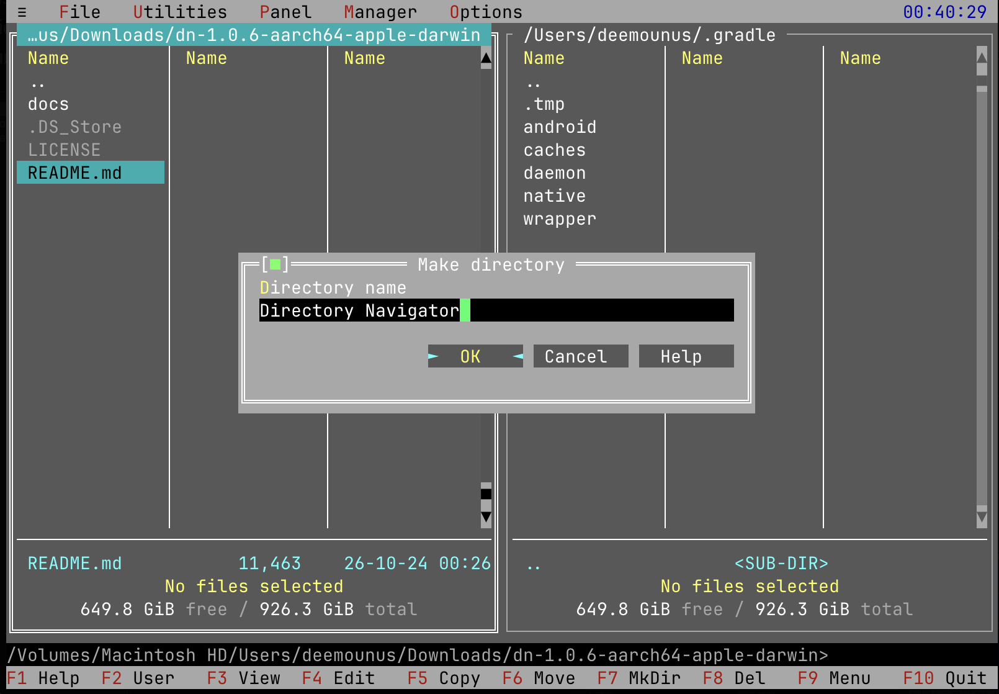

# Directory Navigator

[](https://github.com/deemoun/Directory-Navigator/stargazers)
[](https://crates.io/crates/directory-navigator)
[](https://crates.io/crates/directory-navigator)
[](LICENSE)

[English](README.md) | [Русский](README.ru.md)

Современный терминальный файловый менеджер на **Rust и Turbo Vision**, вдохновлённый
**DOS Navigator**.

Привычные две панели, классические цвета, сочетания клавиш и управление мышью —
для современных компьютеров. Работает прямо в терминале, без эмулятора DOS
или графической оболочки.

Поддерживает **macOS, Windows и Linux**. Последний опубликованный выпуск
устанавливается с [crates.io](https://crates.io/crates/directory-navigator):
`cargo install directory-navigator`. Необходимые инструменты — в разделе
[«Начало работы»](#начало-работы).

<table>
  <tr>
    <td>
      <a href="docs/images/directory-navigator.png">
        
      </a>
    </td>
  </tr>
</table>

## Видео

[](https://youtu.be/QPLtVPms_nY)

[▶ Смотреть на YouTube](https://youtu.be/QPLtVPms_nY)

## На основе Turbo Vision

[Turbo Vision for Rust](https://github.com/aovestdipaperino/turbo-vision-4-rust)
используется для файловых панелей, меню, диалогов, редактора, просмотрщика,
утилит и Tetris. Рабочий стол и система контролов отвечают за перемещение окон,
выделение, фокус и обработку ввода. Directory Navigator сохраняет классический
облик DN и добавляет поддержку Unicode и современных файловых систем.

## Возможности

- Изменяйте права Unix или атрибуты Windows через File Attributes / Info (Alt+E).
- Просмотр двух каталогов рядом, отметка файлов, копирование, перемещение и переименование.
- Создание каталогов и отправка файлов в корзину с подтверждением.
- Поиск файлов, сравнение каталогов, подсчёт размеров папок и закладки.
- Быстрый просмотр текста и шестнадцатеричных данных, редактирование Unicode и текста в старых кодировках, поиск и замена.
- Читайте оформленный Markdown по F3, редактируйте исходник с подсветкой по F4 и просматривайте несохранённый текст по F5.
- Несколько открытых редакторов и просмотрщиков с переключением через **Alt+0**.
- ZIP/ZIP64, TAR, TAR.GZ/TGZ, 7z и RAR прямо в файловых панелях; F5 извлекает выбранные файлы и папки.
- Создавайте ZIP из выбранных файлов и папок, при желании с паролем AES-256; просматривайте и распаковывайте зашифрованные ZIP внутри DN.
- Запуск команд оболочки из командной строки внизу экрана.
- Настройка интерфейса, часов и заставки; выбор цветов текста и фона отдельных элементов в стиле DN, с наборами Color, B/W и Mono. Настройки сохраняются при выходе.
- Привязка расширений файлов к встроенным редактору и просмотрщику или внешним командам.
- Сведения о выделении, свободном и общем месте на диске внизу файловых панелей.
- Английский и русский интерфейс, независимая настройка формата даты и 12/24-часового времени.
- История команд с поиском, копирование имён файлов и путей в системный буфер обмена, с внутренним буфером для консоли.
- Калькулятор, таблица символов и настраиваемое пользовательское меню, а также Tetris и Pentix с отдельными сохраняемыми таблицами рекордов.
- Проверка и изменение отдельных Android APK через подключаемый **APK Workshop**: анализ манифеста и DEX, постоянные рабочие проекты, правка ресурсов и манифеста, экспорт без подписи, а при наличии SDK — подпись и работа с ADB/logcat. Работает без apktool; поддерживаемые изменения и требования SDK описаны в [руководстве](docs/USER_GUIDE.md#apk-workshop) (на английском).
- Воспроизведение локальных **MP3, FLAC, WAV и Ogg Vorbis** в macOS, Linux и Windows: плеер в стиле DN с очередью на время сеанса, импортом папок и подпапок, тегами и длительностью треков, перемешиванием, повтором, паузой, перемоткой и громкостью. По умолчанию плагин выключен; включите его в Options → Configuration → Plugins, затем используйте Utilities → Add music to player. Обычная сборка включает поддержку звука. Основан на DOS Navigator от RIT Research Labs.

## Как это выглядит

<p align="center">
  <a href="docs/images/overlapping-windows-and-colors.png">
    
  </a>
  <br><strong>Классический рабочий стол DN</strong><br>Перемещаемые окна, дерево каталогов и настройка цветов.
</p>

<table>
  <tr>
    <td align="center" width="50%" valign="top">
      <a href="docs/images/tetris-and-pentix-settings.png">
        
      </a>
      <br><strong>Tetris и Pentix</strong><br>Десять уровней, показ следующей фигуры и отдельные таблицы рекордов.
    </td>
    <td align="center" width="50%" valign="top">
      <a href="docs/images/options.png">
        
      </a>
      <br><strong>Настройте под себя</strong><br>Сочетания клавиш, внешний вид и региональные форматы.
    </td>
  </tr>
  <tr>
    <td align="center" width="50%" valign="top">
      <a href="docs/images/editor.png">
        
      </a>
      <br><strong>Встроенный редактор</strong><br>Редактируйте Unicode и текст в старых кодировках, не выходя из терминала.
    </td>
    <td align="center" width="50%" valign="top">
      <a href="docs/images/make-directory.png">
        
      </a>
      <br><strong>Повседневная работа с файлами</strong><br>Создавайте папки через компактные привычные диалоги.
    </td>
  </tr>
</table>

## Начало работы

### Установка с crates.io — основной способ

[Directory Navigator на crates.io](https://crates.io/crates/directory-navigator) —
основной источник установки для **macOS, Windows и Linux**. Установите стабильный
Rust, Cargo и инструменты сборки для своей платформы.
**В Linux сначала установите пакеты из таблицы ниже:** звук включён по умолчанию,
поэтому Cargo нужны `pkg-config` и файлы разработки ALSA. Затем выполните:

```sh
cargo install directory-navigator
dn
```

Устанавливается последний опубликованный выпуск и команда **`dn`**. Для обновления
повторите ту же команду установки. Проверить установленную версию: `dn --version`.
DN открывает текущий каталог. Минимальный размер терминала — **80 столбцов × 25 строк**.

Cargo собирает программу локально. Необходимые инструменты:

- **macOS:** Xcode Command Line Tools (`xcode-select --install`).
- **Windows:** Rust с MSVC и Visual Studio Build Tools с компонентами
  **Desktop development with C++** и Windows SDK.

**Зависимости сборки со звуком в Linux** — выполните команду для своего дистрибутива
перед `cargo install directory-navigator`:

| Дистрибутив | Инструменты сборки и файлы разработки звука |
| --- | --- |
| Debian / Ubuntu / Linux Mint | `sudo apt install build-essential pkg-config libasound2-dev` |
| Fedora | `sudo dnf install gcc pkgconf-pkg-config alsa-lib-devel` |
| Arch Linux / Manjaro | `sudo pacman -S --needed base-devel pkgconf alsa-lib` |

При ошибке **«The pkg-config command could not be found»** или
**«The system library alsa was not found»** установите пакеты из таблицы и повторите
`cargo install directory-navigator`. Проверка наличия обеих зависимостей:
`pkg-config --modversion alsa`. Для других дистрибутивов нужны пакеты с командой
`pkg-config`, заголовочными файлами ALSA и метаданными `alsa.pc`.

Обычная сборка включает звук; сам Music Player включается отдельно в
Options → Configuration → Plugins. Установка без звуковых библиотек:

```sh
cargo install directory-navigator --no-default-features
```

В таком варианте сохраняются обычные ассоциации и внешнее открытие файлов,
а плеер показывает сообщение о недоступности звука. Готовому Linux-бинарнику
со звуком нужны библиотеки ALSA (`libasound2t64`/`libasound2` или `alsa-lib`)
и настроенное устройство вывода, доступное пользователю. Windows использует
WASAPI, macOS — CoreAudio. Внешний плеер, FFmpeg, ASIO SDK и установка кодеков
не требуются.

### Поддерживаемые платформы и проверки

DN поддерживает **macOS, Windows и Linux**. Работа файлового менеджера проверена
нативно на macOS и подтверждена пользователями на Windows и Linux ARM64.
Изменения для Linux и Windows также проходят автоматические тесты и проверки
кросс-компиляции.

| Платформа | Архитектуры | Проверки |
| --- | --- | --- |
| macOS | Apple Silicon / Intel | Нативные тесты, терминальные сценарии и воспроизведение звука на Apple Silicon |
| Windows 10/11 | x86_64 | Пользовательская проверка файлового менеджера; кросс-компиляция и Clippy |
| Linux | x86_64 / ARM64 | Пользовательская проверка файлового менеджера на ARM64; кросс-компиляция и Clippy для обеих архитектур |

Новый звуковой движок Linux/Windows прошёл проверки кросс-компиляции;
воспроизведение через реальное аудиоустройство пока проверено на macOS.

### Альтернатива: готовый исполняемый файл

Скачайте архив для своей системы и архитектуры из релизов проекта или артефактов
ручных сборок. Распакуйте его и запустите `dn.exe` в Windows. В macOS/Linux:

```sh
chmod +x dn
./dn
```

Для готового бинарника Rust и инструменты сборки не нужны. Загруженные сборки
macOS не подписаны и не нотарифицированы, поэтому система может блокировать их.
Рекомендуемая установка через Cargo собирает программу локально.

### Альтернатива: сборка текущих исходников

С теми же инструментами сборки для своей платформы:

```sh
cargo build --release --locked
./target/release/dn
```

В Windows запускайте `target\release\dn.exe`. Для варианта без звуковых библиотек
добавьте к команде сборки `--no-default-features`. MSVC-сборки Windows статически
подключают C runtime через `.cargo/config.toml`.

### Виртуальные консоли Linux

В настоящей виртуальной консоли Linux (`/dev/ttyN`) DN автоматически использует
запущенную службу GPM для мыши. Установите и настройте пакет `gpm` своего
дистрибутива; самому DN не нужны права root или библиотека `libgpm`. Для вывода
используются совместимые с консолью цвета без изменения системной палитры.
В графических терминалах, SSH и tmux сохраняются обычный ввод мыши и расширенные цвета.

**Utilities → System Information** показывает режим терминала, способ вывода
цветов, источник мыши, ошибки GPM и наличие символов в карте консольного шрифта.
Для кириллицы нужен подходящий шрифт: смена локали сама по себе не добавляет
глифы. DN не меняет шрифты или режим клавиатуры. Подробнее в руководстве:
[GPM и цвета консоли](docs/USER_GUIDE.md#mouse-in-a-linux-virtual-console-gpm)
и [устранение проблем с кириллицей](docs/USER_GUIDE.md#cyrillic-in-a-linux-tty)
(на английском).

## Основное управление

При первом запуске открывается приветственное окно с подсказками по клавиатуре,
справкой и настройками клавиш. Его можно открыть снова через **≡ → Welcome…**.
При наличии сохранённых настроек оно автоматически не появляется.

**Классические сочетания DN используются по умолчанию на всех платформах**, включая
macOS. В **Options → Configuration → Keyboard shortcuts** можно выбрать Classic DN,
Mac-friendly или Automatic. Выбранный профиль сохраняется.

В профиле Mac-friendly нажмите **Ctrl+O**, отпустите клавиши, затем нажмите цифру
или букву. Появится подсказка: **5** — копирование, **4** — редактор, **0** — выход.
**Ctrl+O, K** открывает настройки клавиатуры. Классические клавиши также работают;
`^O5` означает Ctrl+O, затем 5. Необязательный профиль Automatic выбирает
Mac-friendly в macOS и Classic DN на остальных платформах.

| Клавиша | Действие |
| --- | --- |
| Tab | Переключение панелей |
| Стрелки / Page Up / Page Down | Перемещение по списку файлов |
| Enter / Backspace | Открыть выбранный элемент / перейти в родительский каталог |
| Insert / Space | Поставить или снять отметку |
| F1 | Справка |
| F2 | Пользовательское меню |
| F3 / F4 | Просмотр / редактирование |
| F5 / F6 | Копирование / перемещение или переименование |
| Ctrl+O | Показать вывод терминала; Ctrl+O/Esc/Enter возвращает в DN (Mac: Ctrl+O дважды) |
| F7 / F8 | Создать каталог / отправить в корзину или удалить с подтверждением |
| F9 / F10 | Меню / выход |
| Ctrl+F7 / Alt+F7 | Рекурсивный поиск / быстрый поиск по имени |
| Ctrl+Q / Ctrl+T | Быстрый просмотр / дерево каталогов |
| Alt+0 | Переключение между файловыми панелями и открытыми документами |

Один щелчок выбирает элемент, двойной открывает его, Ctrl+щелчок ставит отметку.
В просмотрщике и редакторе F1 показывает справку по текущему окну. В macOS для
функциональных клавиш может потребоваться Fn.

**Panel → Filename filter…** (Alt+Del) предлагает маску или выбор нескольких типов
файлов. «Показывать/скрывать выбранные» сравнивает расширения точно, с учётом
регистра (`.jpg` и `.JPG` различаются), и оставляет каталоги видимыми. Используется
загруженный список с текущей настройкой скрытых файлов; отметки сохраняются.
Отмена сохраняет фильтр, сброс очищает только черновик. Подробнее — в
[руководстве](docs/USER_GUIDE.md#filename-filter-and-file-types).

**Manager → Windows…** (Alt+0) переключает между файловыми панелями, редакторами
и просмотрщиками. В профиле Mac-friendly также работает **Ctrl+O, затем U**.
Каждый документ сохраняет собственные изменения, историю отмены, поиск и положение
прокрутки. F4 открывает выбранный файл; повторное открытие активирует уже существующий
документ. Закрытие и выход проверяют несохранённые изменения в соответствующих
редакторах. Редакторы и просмотрщики открываются развёрнутыми; окна можно перемещать,
менять их размер и располагать плиткой (**Tile**) или каскадом (**Cascade**) через
меню Manager или список окон. Геометрию файловых документов можно восстанавливать через настройки сеанса.

Копирование и перемещение используют переключаемое окно **Transfer Center**:
можно продолжать просмотр каталогов и редактирование, пока одна операция выполняется,
а остальные ждут в очереди. **Manager → Transfers…** снова открывает ход выполнения
и результаты. Закрытие окна не останавливает работу; ошибка или отмена приостанавливает
очередь до её возобновления. Замена существующих файлов требует подтверждения;
каталоги можно объединять. Подробнее — в разделе
[о больших файлах и замене](#большие-файлы-и-замена-существующих-файлов).

Нижняя строка — командная. Введите команду и нажмите **Enter**, чтобы выполнить её
в каталоге активной панели; **Esc** очищает строку. **Ctrl+E / Ctrl+X** вызывают
историю команд. `cd "folder name"` меняет каталог активной панели. Если строка пуста,
Enter открывает выбранный элемент. Команды оболочки выполняются с вашими обычными
правами, независимо от подтверждений файловых операций самого менеджера.

**Утилиты → Журнал команд** возвращает команду в строку, не выполняя её.
В System Setup можно включить **Сохранять историю команд**: только последующие
команды сохраняются открытым текстом в `command-history.toml` рядом с конфигурацией
(100 команд / 1 МиБ), независимо от сохранения настроек при выходе. По умолчанию
это выключено. Выключение оставляет файл; **Очистить историю…** после подтверждения
удаляет историю сеанса и сохранённые команды, сохраняя текущую строку.

В отчёте сравнения доступны фильтры «Все / Разные / Только слева / Только справа /
Одинаковые / Не сравнены» и обновление исходных каталогов. При обновлении прежний
снимок остаётся видимым с отметкой об устаревании; отменённый результат помечается
неполным. В Transfer Center можно **Открыть назначение** для однозначного локального
пути и **Копировать сведения** в системный или внутренний буфер. **Продолжить очередь**
запускает ожидающие задания без повтора сбойных.

## Настройки и работа с файлами

Настройки загружаются автоматически и сохраняются при штатном выходе.
**Options → Save desktop** сохраняет их сразу; **Options → Configuration → System Setup**
управляет сохранением при выходе.

- macOS/Linux: `~/.config/dn/config.conf` или `$XDG_CONFIG_HOME/dn/config.conf`.
- Windows: `%APPDATA%\Directory Navigator\config.conf`.

**Options → Configuration → Language / date & time** меняет язык интерфейса,
порядок даты (год/месяц/день, день/месяц/год или месяц/день/год), разделитель даты
и 12/24-часовой формат времени с настраиваемым разделителем. Apply принимает
изменения, Cancel оставляет прежние настройки. Часы, даты в панелях и сведения
о файлах используют эти параметры. По умолчанию выбраны английский язык,
год-месяц-день и 24-часовое время. Английский и русский каталоги переводов встроены
в программу, отдельные файлы для них не нужны. Непереведённые сообщения выводятся
на английском, а системные ошибки сохраняют исходный текст.

`config.conf` использует TOML с `config_version = 2` и разделами настроек.
Поддерживается только этот формат; старые плоские файлы не преобразуются.
Некорректный файл переименовывается в `_old_config.conf` (с номером, если имя занято),
после чего загружаются значения по умолчанию. При обычном сохранении создаётся новая
конфигурация; недоступные файлы, файлы только для чтения и ошибки восстановления
по-прежнему вызывают сообщения об ошибках. Неизвестные параметры TOML сохраняются.
Автоматически загружается только `config.conf`; `config.txt` игнорируется.

**Options → Import DOS settings…** читает оригинальный `DN.CFG` и показывает
поддерживаемые настройки часов, скрытых файлов, сортировки, подсветки, выделения,
редактора и заставки. Apply применяет их к текущему сеансу; обычное сохранение
записывает их на диск. Cancel ничего не меняет, исходный DOS-файл не изменяется.
DOS-пути, окна рабочего стола, команды, аппаратные настройки и пользовательские
палитры не импортируются; защита корзины и подтверждения сохраняются.
Совместимость проверена на тестовых данных, полученных из исходников;
реальный пользовательский `DN.CFG` пока не проверялся.

По умолчанию удаление отправляет файлы в корзину; ошибка корзины никогда не
приводит к автоматическому безвозвратному удалению. Безвозвратное удаление можно
выбрать в File Manager Setup; подтверждение всё равно требуется. Обнаруженные
изменения поставленных в очередь элементов или их родительских каталогов
останавливают операцию. Отмена или ошибка сохраняет уже выполненную работу;
автоматического отката многофайловых операций нет.

ZIP поддерживает подтверждаемые обновления; другие архивы доступны только для чтения.
Просмотр и редактирование текста ограничены указанными ниже пределами. Важные сценарии
проверяйте на копиях. В сообщении о проблеме указывайте ОС, терминал и шаги
воспроизведения. Подробные сочетания клавиш, ограничения и настройка
пользовательского меню описаны в [руководстве](docs/USER_GUIDE.md) (на английском).

### Ошибки и предупреждения

Ошибки основных файловых команд поясняют действие, путь, известный результат и
следующий шаг. В разделе **Причина** сохраняются исходные сообщения системы или
библиотеки. При сбое передачи часть работы может быть завершена — проверьте Transfer
Center перед повтором. Предупреждение после публикации означает, что файл записан:
оставьте редактор открытым и следуйте подсказке. DN не повторяет операции сам,
не отменяет подтверждения и не запускает другое приложение автоматически.

### Восстановление сеанса

**Options → Configuration → System Setup → Восстанавливать сеанс** предлагает
**Выкл. / Только панели / Панели и документы**. По умолчанию выбраны только панели:
восстанавливаются оба каталога, курсор, фильтр, прокрутка и активная панель. Отметки
файлов очищаются; вместо архива открывается содержащий его каталог.

Режим документов также открывает файловые просмотрщики и редакторы, восстанавливая
позиции и расположение окон. Содержимое перечитывается с диска. Несохранённый текст
защищён обычными подтверждениями и аварийным восстановлением. Пароли, служебные окна,
члены архивов, предпросмотры, передачи и состояние плеера не сохраняются.

**Save desktop** сохраняет снимок сразу; штатный выход — только при включённом
сохранении настроек при выходе. **Load desktop** перечитывает настройки, не заменяя
открытые документы. Команда `dn --no-session` пропускает восстановление и открывает
каталог запуска. Недоступные элементы пропускаются с общим уведомлением. Снимок
хранится в том же защищённом файле настроек: не более 128 документов и 1 МиБ на весь
файл конфигурации.

### Большие файлы и замена существующих файлов

F3 читает большие обычные дисковые файлы ограниченными окнами, поддерживая
прокрутку, переход к строке или байту, End и поиск по всему файлу. Предпросмотр
архивных файлов, PDF и оформление Markdown сохраняют описанные в руководстве
ограничения; большие дисковые Markdown-файлы показываются как исходный текст.
F4 поддерживает до 64 МиБ в Unicode-буфере и записываемых байтах, до 1 000 000 строк.
Слишком большие документы и сохранения отклоняются без усечения содержимого.

При копировании, перемещении и распаковке замена файлов по умолчанию требует
подтверждения: **Заменить / Пропустить / Заменить все / Пропустить все / Отмена**.
Изначально выбрано «Пропустить»; выбор «все» относится только к текущей операции.
Esc отменяет её, сохраняя выполненную работу. Каталоги объединяются рекурсивно,
посторонние файлы сохраняются. Доступны и явные режимы отказа и пропуска конфликтов.
Конфликты файла с каталогом, ссылки и специальные назначения отклоняются.
**«Сохранить как»** предлагает **Заменить / Отмена** с безопасным выбором «Отмена»;
обычный F2 сохраняет проверку внешних изменений.

### Анализ объёма каталогов

**Ctrl+T → Анализ (F5)** считает размеры папок в фоне; открытие дерева само по себе
не запускает рекурсивный обход. **F6** меняет порядок Имя/Размер среди соседних
каталогов после остановки анализа. Размеры и полосы учитывают скрытые файлы;
жёсткие ссылки считаются отдельно, ссылки на каталоги не обходятся. Другие файловые
системы исключаются. Свободное/общее место тома показано отдельно. Стоп или Esc
останавливает анализ, сохраняя явно помеченные частичные итоги; ещё один Esc
закрывает дерево. Обновление помечает затронутые снимки устаревшими. Результаты
живут только в текущем окне дерева. Это размеры файлов, а не занятое или
освобождаемое место. Подробнее — в [руководстве](docs/USER_GUIDE.md#directory-tree-and-disk-usage).

### Большие архивы и обновление ZIP

Поддерживаются архивы до 64 ГиБ и 100 000 элементов с ограниченным объёмом
метаданных. Доступен ZIP64; создание ZIP принимает до 64 ГиБ исходных данных.
Просмотр и распаковка RAR и 7z выполняются внутри DN, включая запрос пароля;
внешний архиватор не нужен. Вложенные и многотомные архивы не поддерживаются.

Откройте ZIP в одной панели и нажмите F5 на дисковых файлах в другой, чтобы
добавить их. Диалог **«Обновление ZIP»** требует явного подтверждения замены
совпадающих элементов. F8 внутри ZIP подтверждает удаление выбранных файлов
и деревьев папок. В обоих диалогах изначально выбрана отмена. F4 открывает
текстовый файл ZIP в частной рабочей папке; F2 сохраняет его через пересборку
ZIP во временный файл, а «Сохранить как» экспортирует обычный дисковый файл.
Остальное содержимое сохраняется; ошибка оставляет исходный ZIP и несохранённый
текст редактора. Для обновления нужно место под новый архив. Другие форматы
доступны только для чтения. Подробнее — [работа с ZIP](docs/USER_GUIDE.md#zip-member-updates)
(на английском).

### Кодировки текста

Просмотрщик и редактор поддерживают UTF-8, UTF-16 LE/BE, CP866, Windows-1251,
KOI8-R и Windows-1252. BOM и корректный UTF-8 определяются автоматически;
для другого похожего на текст содержимого открывается выбор кодировки с
предпросмотром. F8 меняет кодировку; в редакторе файл перечитывается после
обработки несохранённых изменений. F2 сохраняет кодировку, BOM и смешанные
переводы строк. **File → Save with encoding…** явно преобразует формат;
непредставимые символы блокируют запись, а не заменяются. Новые документы
используют UTF-8 без BOM. Подробнее — [кодировки текста](docs/USER_GUIDE.md#text-encodings-in-f3-and-f4)
(на английском).

### Просмотр изображений

F3 открывает PNG, JPEG и WebP во встроенном просмотрщике с обычными окнами DN.
F2 вписывает изображение; F3 задаёт 100% (пиксель исходника на столбец с коррекцией пропорций);
F4 поворачивает по часовой стрелке; F5/F6 меняют масштаб; стрелки перемещают
изображение; F8 переключает цветные полублоки и ASCII; Esc/F10 закрывает окно.
Поворот не изменяет файл. Прозрачность отображается на шахматном фоне, ориентация
JPEG учитывается автоматически. Фоновая фильтрация с учётом прозрачности
уменьшает искажения при уменьшении. Пропорции используют размеры ячейки,
сообщённые ОС; при отсутствии данных сохраняется приближение 1:2. Измерения
выполняются при запуске, изменении размера и возвращении в терминал, вне
отрисовки. Настоящая Linux-консоль сохраняет свой запасной режим. Превью из ячеек с 256 цветами работает на macOS, Linux
и Windows, включая Linux tty с существующим преобразованием консольных цветов.
Это превью низкого разрешения; Kitty, Sixel и iTerm2 пока не используются.
Если в шрифте нет полублоков, выберите ASCII. Ограничения: 64 МиБ исходных байтов,
33 554 432 пикселя и 32 768 пикселей по каждой стороне. Повреждённые и слишком
большие изображения отклоняются. Для WebP показывается первый кадр. Ассоциации
Enter, явные команды «Как текст»/«Как Hex» и быстрый просмотр не изменяются.
Изображения внутри архивов, анимация, SVG, HEIC и RAW пока не поддерживаются.

### Просмотр текста PDF

F3 открывает извлечённый текст PDF внутри DN: страницы, поиск и переход по номеру
страницы. Enter сохраняет внешнее открытие. Поддерживаются файлы внутри архивов.
Для зашифрованного PDF появляется скрытое поле пароля с повторным вводом и отменой.
Пароли PDF и ZIP вводятся отдельно и не сохраняются. Графический просмотр и OCR
пока не реализованы.

### Открытие TXT внутри DN

Включите **Опции → Файловый менеджер → Настройка → Открывать TXT во встроенном
просмотрщике**, чтобы Enter и двойной щелчок открывали `.txt` / `.TXT` внутри DN
на всех трёх платформах. По умолчанию флажок выключен; при включении он имеет
приоритет над ассоциациями TXT. Ctrl+Enter открывает файл внешним приложением.
F3 и F4 сохраняют обычные действия просмотра и редактирования.

### Tetris, Pentix и оригинальные рекорды

Чтобы импортировать таблицы рекордов DOS Navigator, поместите **`dn.tet`**
(или `DN.TET`) рядом с `config.conf`, затем откройте или переоткройте игру.
Обе оригинальные таблицы объединятся с соответствующими Top Ten в `tetris.conf`
без повторного импорта. Исходный файл останется нетронутым. Режим Classic Tetris
или Pentix выбирается в Setup; Pentix использует все 27 оригинальных фигур
из одной–пяти клеток.

DOS-файлы не содержат сведений о кодировке: при первом импорте используется CP437
для английского или CP866 для русского, в зависимости от языка интерфейса.
Выбор запоминается в файле Tetris. Новые рекорды поддерживают имена в Unicode;
если в оригинальной записи нет числа строк, показывается «—».

## Разработка

Подробности реализации — в [документации об основах работы с документами](docs/DOCUMENT_FOUNDATIONS.md)
(на английском).

```sh
cargo fmt --check
cargo clippy -- -D warnings
cargo test
cargo build --release
```

В GitHub откройте **Actions → Build all platforms → Run workflow**, чтобы проверить
и собрать macOS (Apple Silicon и Intel), Linux (x86_64 и ARM64) и Windows (x86_64).
Каждое успешно завершённое задание загружает архив с исполняемым файлом, README
и лицензией MIT, а также контрольную сумму SHA-256. Файлы находятся в разделе
**Artifacts** этого запуска и хранятся 30 дней. Сборки не подписаны; этот процесс
не публикует GitHub Release. **Rust checks** также запускается только вручную:
откройте его в Actions и выберите **Run workflow**. Оба процесса не запускаются
при push, pull request или по расписанию.

### Проверка пакета crates.io

Имя пакета в реестре — `directory-navigator`, исполняемого файла и Rust-библиотеки —
`dn`. Зависимости используют опубликованные версии crates.io, включая неизменённый
Turbo Vision 4.1.0. Адаптеры ячеек терминала и переведённых подписей входят в DN;
форк библиотеки не требуется.

Перед ручной публикацией проверьте `cargo package --list`, выполните
`cargo publish --dry-run` и сверьте версию исполняемого файла. В пакет должны
входить исходники, переводы, тестовые данные, README, изображения документации,
`LICENSE` и `THIRD_PARTY_NOTICES.md`. Пробная публикация не загружает пакет в реестр.

### Пакеты Debian

Для загрузки `.deb` или собственного APT-репозитория используйте
`scripts/package_deb.py` в нативной среде Debian/Ubuntu архитектуры `amd64` или
`arm64`. Скрипт собирает DN со звуком, определяет зависимости времени выполнения,
проверяет пакет и сохраняет контрольную сумму SHA-256 в `target/debian/`.
Дополнительный тест в Docker проверяет установку, обновление и удаление, не
устанавливая DN на хост. Автоматической загрузки пакетов нет. Требования,
контакт сопровождающего и команды приведены в
[руководстве по пакетам Debian](docs/DEBIAN_PACKAGING.md) на английском языке.
Ручной workflow **Actions → Build Debian packages** собирает и проверяет обе
архитектуры. Артефакты `dn-deb-x86_64` и `dn-deb-arm64` содержат `.deb` и контрольные
суммы; релиз GitHub или его черновик не создаётся.

### Общий выпуск для всех платформ

После отправки workflow в основную ветку откройте **Actions → Build unified release
→ Run workflow**, выберите исходную ветку и укажите версию **без `v`**, например
`1.0.0` или `1.1.0-beta.1`.

Ручной процесс собирает все пять целей: macOS Apple Silicon и Intel, Windows
x86_64, Linux x86_64 и ARM64. Для Apple Silicon, Windows и Linux сохраняются
строгий Clippy для всех целей, модульные тесты библиотеки и выбранные проверки
файловых операций, передачи, архивов, редактора/recovery, кодировок, настроек и
локализации, а также тесты без звука. Полный набор интеграционных и терминальных
UI-тестов вынесен из проверки выпуска. Для Intel macOS остаются проверка
форматирования, release-сборка, запуск CLI с `--version` и `--help` и проверка
пакета: дополнительные сборки для разработки и тестов не расходуют время релиза.
Отдельный процесс **Build all platforms** сохраняет полный набор тестов Intel
при необходимости. Для полной проверки откройте **Actions → Unified Release Full Tests**
и укажите ту же ветку и версию. Этот процесс выполняет полный Clippy и все тесты
на пяти платформах, включая Intel, и сохраняет только бинарные артефакты. Он не
создаёт тег, черновик или опубликованный релиз; можно проверять уже выпущенную
версию. Все тесты остаются доступными локально и в ручных процессах полной проверки.
В обычном процессе выпуска версия встраивается в приложение,
окно About и CLI, затем создаётся **неопубликованный черновик релиза** с тегом
`v<version>`. Предварительные версии отмечаются автоматически.

Для скачивания создаются пять архивов с версией в имени: четыре TAR.GZ и ZIP
для Windows. Каждый содержит исполняемый файл, README, руководство пользователя
и лицензию MIT. Файлы контрольных сумм используются для внутренней проверки
сборок и не прикрепляются к релизу. Имена Linux-архивов:
`dn-<version>-linux-x86_64.tar.gz` и `dn-<version>-linux-aarch64.tar.gz`.

Тег указывает на точное дерево исходников с версией, использованное для всех
сборок. При необходимости отдельный коммит релиза обновляет Cargo.toml/Cargo.lock;
ветка разработки не переписывается, её версия не меняется. Следующую версию ветки
при необходимости задавайте отдельно. Только финальное задание получает право
записи в репозиторий; тег и черновик не создаются, пока не пройдут все пять сборок.
Существующие теги и релизы не перезаписываются. Если публикация завершилась ошибкой
после создания тега или черновика, проверьте эту версию в GitHub: завершите черновик
вручную либо осознанно удалите частичный черновик/тег перед новым запуском.
При восстановлении процесс не удаляет и не заменяет существующие релизы.

Проверьте черновик, скачанные сборки и примечания к выпуску, затем опубликуйте
релиз самостоятельно. Сборки macOS остаются неподписанными и ненотарифицированными;
сборки Windows также не подписаны. Репозиторий должен разрешать Actions запись
содержимого и создание тегов; строгие правила тегов могут блокировать финальное
задание. Все процессы запускаются только вручную, а не при push или создании тега.

### Отдельные сборки Windows и Linux

Эти процессы независимы от общего выпуска и работают только при выборе
**Run workflow**. Выберите исходную ветку и укажите версию без `v`.

| Процесс в Actions | Цели | Файлы в разделе Artifacts запуска |
| --- | --- | --- |
| **Build Windows** | Windows x86_64 | **windows-downloads**: ZIP с `dn.exe` |
| **Build Linux** | Linux x86_64 и ARM64 | **linux-downloads**: два архива TAR.GZ с `dn` |

Оба процесса проверяют, тестируют и собирают приложение, сверяют версию
исполняемого файла и включают README, руководство пользователя, лицензию MIT,
отдельные контрольные суммы SHA-256 и `SHA256SUMS.txt`. Файлы хранятся 30 дней.
Теги, GitHub Releases и черновики не создаются. Указанная версия встраивается
в исполняемые файлы; исходная ветка не меняется. Сборки Windows не подписаны.
Успешная сборка не заменяет проверку в Windows Terminal или терминале Linux.

Тесты вспомогательных скриптов выпуска (Python 3.12+, только стандартная библиотека):

```sh
python3 -m unittest discover -s scripts -p 'test_*.py'
```

Исходники приложения на Rust находятся в `src/`, тесты — в `tests/`.

## Сетевая информация и удалённые файлы

**Утилиты → Сетевая информация** показывает локальные интерфейсы, MAC-адреса,
IPv4/IPv6, шлюзы и DNS-серверы выбранного адаптера. Выпадающий список позволяет
переключать интерфейсы; обновление сохраняет выбор, пока адаптер доступен. Скорости
приёма и отправки обновляются примерно раз в секунду в B/s, KiB/s и более крупных
единицах, учитывая весь трафик выбранного адаптера. Это не проверка скорости Интернета.
После смены адаптера измерение начинается заново; недоступность счётчиков отображается явно. Этот снимок не проверяет доступность Интернета.
Основные пути DN и системы остаются в **Системной информации**.

**Утилиты → Удалённые соединения…** открывает встроенный клиент SFTP, явного
FTPS и FTP. Удалённый каталог открывается в любой панели: F3 — просмотр,
F4 — редактирование с сохранением на сервер, F5 — скачивание или загрузка,
F7 — создание каталога, F8 — окончательное удаление после подтверждения.
Переименование работает с одним элементом. Ctrl+PgUp отключает соединение и
возвращает исходный локальный каталог. Ошибка или отмена загрузки сохраняет
прежний удалённый список. **Панель → Переподключить удалённую панель…** запрашивает
пароль заново и сохраняет каталог, фильтр, курсор, отметки и прокрутку в доступных
пределах. Принятые передачи не перезапускаются. Состояние связи определяется
по выполненным операциям, без постоянной проверки.

Профили рядом с конфигурацией DN содержат параметры соединения и подтверждённые
отпечатки SSH, но не пароли и не парольные фразы ключей. В списке «Профили»
можно выбрать, изменить, переименовать или удалить профиль с подтверждением. Перед первым входом
проверьте отпечаток; изменившийся сохранённый ключ отклоняется. Предпочитайте
SFTP или FTPS: обычный FTP передаёт пароли и файлы без шифрования. FTPS проверяет
сертификаты и не переключается на незашифрованный FTP при ошибке.

Скачивание использует локальную подготовку и обычные подтверждения замены DN.
Загрузка сначала подготавливает файл на сервере, затем переименовывает его;
гарантии публикации FTP зависят от сервера. Замена через SFTP требует расширения
атомарного переименования. Ссылки не обходятся, исходники при передаче не удаляются.
Прямая передача между двумя серверами и автоматическое восстановление соединений
пока не поддерживаются. **Терминал SSH** запускает установленный клиент OpenSSH
`ssh`, использующий собственные проверки ключей и аутентификацию; после выхода
восстанавливается DN. Рабочий каталог командной строки остаётся локальным.
Подробнее — в [руководстве](docs/USER_GUIDE.md#remote-connections).

## Передача между соседними DN

**Отправить текст…** передаёт ссылки и многострочный текст Unicode выбранному
получателю или по параметрам подключения вручную. В отдельном окне доступны
**Вставить / Очистить / Отправить / Отмена**. Enter добавляет строку, Tab выбирает
кнопки. Предел — 64 КиБ UTF-8; превышение отклоняется без усечения. Получатель
фиксируется при открытии окна. Черновик сохраняется после отмены или ошибки
до закрытия Nearby.

После проверки кода получатель принимает предложение с именем отправителя и
числом байт, затем просматривает текст и выбирает **Копировать** или закрытие
просмотра. Буфер обмена не меняется без команды; ссылки не открываются. В консоли
доступен внутренний буфер DN. До закрытия просмотра другое предложение не
принимается. Подтверждение отправителю означает приём текста другим DN, а не
копирование. При потере подтверждения доставка остаётся неподтверждённой.
Файлы, задания передачи и постоянная история не создаются; синхронизации буферов
нет. Для текста нужны две версии с поддержкой этой функции; совместимость
передачи файлов сохраняется.

**Проверить связь** проверяет соединение и двустороннее подтверждение кода без выбора и отправки файлов. На другом DN включите **Приём**; обе версии должны поддерживать проверку связи. Сначала выберите получателя или введите параметры вручную. В поле **Этот DN** можно задать имя и нажать Enter; оно действует до выхода из DN. Пустое имя возвращает анонимное значение. **Об устройстве…** показывает полный публичный идентификатор, локальные интерфейсы и IP:порты. Имя не подтверждает личность.

**Утилиты → Передача между DN…** открывает отправку и приём в локальной сети.
Плагин включён по умолчанию, но не запускает сеть до выбора **Приём**,
**Обновить**, **Проверить связь** или **Выбрать из панели**. **Файл → Отправить в соседний DN…** фиксирует видимые
отмеченные файлы и папки либо текущий элемент. Сначала извлеките элементы
архива или скачайте удалённые файлы.

Выберите получателя, сравните **восемь цифр на обоих экранах** и подтвердите
соединение на обоих компьютерах. Получатель проверяет предложение и выбирает
существующую локальную папку. Передача использует прямое шифрованное соединение
QUIC через Iroh без ретрансляторов, публичного поиска, настройки портов шлюза
и проверок интернета. Если multicast заблокирован, скопируйте параметры
соединения вручную; UDP между компьютерами всё равно должен быть разрешён.
Имя по умолчанию содержит случайный идентификатор сеанса, без имени пользователя или хоста.

Центр передач показывает прогресс, отмену, запросы замены и результат. Закрытие
окна приёма прекращает поиск и новые предложения, но принятые задания продолжаются.
Проверка запоминается только до выхода из DN; каждое предложение требует согласия.
**Обновить** повторно проверяет интерфейсы и запускает поиск, сохраняя выбор файлов.
Новые интерфейсы ВМ подключаются автоматически вне активного сеанса; иначе
обновление откладывается до его завершения. Состояние различает отсутствие объявлений
и обнаруженные адреса вне подключённых сетей. При вводе адреса вручную DN выбирает
подходящие адреса и назначает локальные области IPv6; маршрутизируемые сети и NAT
без прямого доступа не разрешаются.
Одновременно поддерживается один сеанс. Ссылки, специальные файлы, удалённая
навигация и возобновление не поддерживаются. Ограничения и гарантии описаны в
[руководстве](docs/USER_GUIDE.md#nearby-dn-transfers).

## Экспериментальные плагины DOS и звуковой передачи

Оба плагина **выключены по умолчанию**, в том числе после обновления без явного
сохранённого выбора. Включение: **Параметры → Конфигурация → Плагины**. Само
включение не запускает эмулятор, звуковые устройства или сеть.

- **Запуск DOSBox (экспериментальный)** использует установленный **DOSBox,
  DOSBox-X или [DOSBox Staging](https://www.dosbox-staging.org/)**. Откройте
  **Утилиты → Запуск DOSBox…**, нажмите **Найти эмуляторы** и выберите программу
  из списка либо укажите путь вручную. Пустое поле включает автоматический выбор:
  сначала Staging, затем DOSBox-X, затем классический DOSBox. Проверяются PATH,
  обычные каталоги установки и экспортированные запускатели Snap/Flatpak в Linux.
  **Файл → Запустить в DOSBox…** запускает текущий обычный COM, DOS EXE или BAT
  в отдельном графическом окне. Флажок **Открывать программы DOS через DOSBox**
  включает Enter/двойной щелчок для COM и DOS MZ раньше ассоциаций.
  Windows PE/NE/LE/LX исключены; BAT запускается только явно. Ctrl+Enter и
  **Открыть системным приложением** обходят плагин. Глобальные настройки эмулятора
  сохраняются; автоматическая загрузка настроек из каталога игры отключена.
  **Настройки DOS…** задают общий профиль: скорость ЦП (настройки эмулятора,
  фиксированная или максимальная), число циклов от 50 до 2 000 000, память
  1/2/4/8/16/32/63 МиБ и оконный/полноэкранный режим. По умолчанию все значения
  наследуются от эмулятора. OK страницы меняет черновик, OK запускателя применяет
  его с обычным сохранением конфигурации. Сброс действует только на черновик.
  Изменения касаются последующих запусков. DN загружает приватный файл изменений
  после пользовательских настроек, не редактируя файлы эмулятора и игр. Временный
  файл удаляется после завершения эмулятора; если DN завершился раньше, он остаётся
  для системной очистки временных файлов.
  Эмулятор не входит в DN, необходима графическая среда. **Проверить DOSBox**
  проверяет путь и профиль из черновика без запуска игры и проверки графического вывода.
  Проверки можно отменить; они не сохраняют настройки. Ограниченная диагностика
  ошибок остаётся в окне и справке; фоновые результаты не перехватывают фокус.
  Закрытие окна отменяет ожидающие проверки, но уже запущенные игры продолжают работать.

  **Разрешение окна** по умолчанию выбрано **Автоматически** — настройки
  эмулятора сохраняются. Доступны 640x480, 800x600, 1024x768, 1280x960,
  1600x1200 и 1920x1080. Это размер окна, а не видеорежим DOS или разрешение
  полного экрана; масштаб ОС, пропорции и рабочий стол могут изменить результат.
  Режим `surface` в DOSBox/DOSBox-X может игнорировать размеры; DN не меняет
  способ вывода. Для Staging 0.83+ используется `window_size`, для прежних —
  `windowresolution`. При неизвестной версии Staging выберите «Автоматически»
  или программу с определяемой версией. Сброс и вложенные OK/Отмена сохраняются.

  **Настройки DOS… → Диски DOS…** добавляет диск для обычных DOS-программ:
  **Выключено** (по умолчанию), **Временный диск DN** или настоящая **Папка**.
  Доступны буквы **D:–X:**; C: оставлена программе, Y:/Z: — утилитам эмулятора.
  Выбранная дополнительная буква переназначается для запуска. Файлы не стираются
  и доступны DOS-программам для записи. Используется постоянный временный диск DN;
  он создаётся только при запуске, не при настройке или проверке. **Обзор…**
  открывает дерево каталогов. Рабочим каталогом процесса эмулятора становится
  подключаемая папка; команда `MOUNT <буква> .` сохраняет пути Unicode.
  Относительные команды пользовательского autoexec разрешаются от этой папки.
  Полный путь запускаемой программы сохраняется, её каталог остаётся C:.
  Глобальная конфигурация и запрет автоматической конфигурации из папки игры
  сохраняются. Вложенный OK меняет черновик, OK запускателя применяет настройки;
  запись на диск выполняет обычное сохранение конфигурации. На образы Windows 9x
  дополнительный диск не влияет.

  **Windows 9x…** на главной странице запускателя DOS хранит до **32 образов**,
  для каждого — версию Windows, память, путь к DOSBox-X и флажки полного экрана,
  захвата мыши, SB16 и Voodoo. **Сохранённый образ** открывает список с пунктом
  **Новый профиль образа…**. **Сохранить профиль** сразу записывает настройки через
  хранилище конфигурации с блокировкой, независимо от сохранения при выходе;
  другие несохранённые настройки не записываются. **Убрать профиль** удаляет запись,
  сохраняя файл образа. Отмена отбрасывает несохранённые изменения, но уже
  сохранённые профили остаются. Прежний одиночный образ сохраняется при чтении
  старой конфигурации. **Запустить Windows** находится на главной странице и
  использует выбранный сохранённый профиль. Нужен DOSBox-X и raw-образ HDD
  (`.img`/`.ima`) с разделами FAT и установленной Windows 95/95 OSR2/98/98 SE.
  Проверка проверяет программу и заголовок, но не работоспособность Windows.
  Гостевая ОС **изменяет образ**: сделайте копию и закройте другие эмуляторы.
  Обычные настройки DOS независимы. Обычное ядро CPU может быть медленным,
  особенно на ARM; гостевая сеть, преобразование папок хоста и пользовательский
  autoexec отключены. Установщик, образ диска и лицензия Windows не предоставляются.
- **Акустическая передача (экспериментальная)** требует сборки
  `cargo build --release --locked --features acoustic` и отключена по умолчанию.
  **Отправка открывает только динамик, приём — только микрофон.** Ответный звук
  и синхронный обмен подтверждениями не нужны. Введите одинаковую сильную
  парольную фразу на обоих компьютерах. Пронумерованные блоки повторяются
  по кругу: пропущенное можно собрать на следующем повторе. Доступны 1/2/3
  повтора или повторение до Стоп.
  Передаётся **текст UTF-8 или один обычный файл до 1 МиБ**. Данные сжимаются,
  если это уменьшает размер. **Оценить** вычисляет длительность без открытия
  звуковых устройств. Есть режимы Обычная/Быстрая/Максимальная; большие файлы
  могут передаваться часами или днями. **Экспорт WAV… / Приём WAV…** работают
  без воспроизведения и звуковых устройств. Экспорт потоковый, в обычный WAV (RF64 для больших записей);
  приём поддерживает PCM16/24/32 и float32, 1–8 каналов, 8–192 кГц, до 64 ГиБ.
  Для экспорта выберите конечное число повторов.
  Argon2id и XChaCha20-Poly1305 защищают данные. Только полностью проверенное
  содержимое предлагается принять или сохранить; замена файлов защищена общими
  проверками. Отправитель сообщает **«Передача завершена»**, но не подтверждает
  доставку. Пароль, черновики и предпросмотр не сохраняются. Протокол 2 требует
  обновлённого DN на обеих сторонах и несовместим с прежним двусторонним модемом.
  Надёжность на реальных динамиках и микрофонах пока не подтверждена.

Подробнее — в [руководстве по экспериментальным плагинам](docs/USER_GUIDE.md#experimental-dos-and-acoustic-plugins).

## Объединение видео

Включите **Объединение видео** в **Options → Configuration → Plugins**;
по умолчанию плагин отключён. Выберите локальные видео или папки и команду
**File → Merge videos…** либо откройте **Utilities → Video Merge…**. Установите
`ffmpeg` и `ffprobe` отдельно, добавьте в PATH или укажите пути в настройках плагина.

**Анализ** проверяет клипы и исключает точные дубликаты. Проверьте порядок и
параметры перед запуском. Авто объединяет совместимые потоки без перекодирования;
иначе предлагаются размер и точная частота кадров первого клипа. Выход — MP4,
доступны H.264/H.265, обнаруженные аппаратные кодировщики и управление звуком.
При необходимости HDR/10-битное видео автоматически преобразуется в SDR (BT.709);
совместимые потоки копируются с сохранением HDR. Уведомление не блокирует запуск.
Замена результата требует подтверждения; ошибка клипа останавливает задание.
Необязательный CSV содержит имена и время, без GPS и полных путей. Постоянного
кэша нет. Подробнее — в [руководстве](docs/USER_GUIDE.md#video-merge).

Автоматическая обработка предпочитает проверенное аппаратное кодирование при
преобразовании. В настройках есть список обработки, параметры источника и
дополнительная страница. Показаны прошедшее время, оценка оставшегося преобразования
и итоговое время. Проверка скорости использует приватные образцы без публикации.

## Передачи по Bluetooth

Откройте **Утилиты → Передачи по Bluetooth…** на обоих компьютерах.
Встроенный плагин включён по умолчанию; его можно отключить в настройках плагинов.
При старте DN он не обращается к Bluetooth. Сначала сопрягите компьютеры
в системных настройках. На получателе нажмите **Приём**, на отправителе обновите
список сопряжённых устройств, выберите получателя и отправьте очередь.
Окно берёт отмеченные локальные файлы либо текущий файл; кнопка **Взять выбранные
файлы** повторяет захват. Каждый входящий файл требует подтверждения и выбора
локального каталога; замена существующего файла подтверждается отдельно.

Очередь хранится до закрытия окна: до 256 обычных файлов, каждый меньше 4 ГиБ.
Папки, ссылки и элементы архивных или удалённых панелей не поддерживаются.
Отправка очереди и принятые входящие файлы отображаются в Центре передач:
прогресс, отмена и подтверждение замены. Разрешение приёма остаётся в окне
Bluetooth. Его закрытие прекращает новые предложения; принятая работа продолжается.
Ожидание в очереди входит в общий срок ответа получателя. Завершённые файлы
сохраняются при отмене. Потеря последнего подтверждения означает, что доставка
не подтверждена: перед повтором проверьте каталог получателя.

Используются IOBluetooth на macOS, BlueZ и системная D-Bus на Linux (включая tty),
Bluetooth Classic на Windows. На Mac терминалу может потребоваться разрешение
Bluetooth. Протокол — обычный OBEX с отдельным идентификатором службы DN:
на этом этапе получателем должен быть второй DN, а не телефон или системный
приёмник файлов. Адаптера только с BLE недостаточно. Аппаратная совместимость
проверяется отдельно от тестов протокола и интерфейса.
Подробнее — в [руководстве](docs/USER_GUIDE.md#bluetooth-transfers).
Acoustic остаётся отдельной необязательной возможностью сборки и не входит
в обычную сборку.

### Сравнение каталогов и диагностика плагинов

В «Панель → Сравнить каталоги» сохранено быстрое сравнение по метаданным.
Кнопка «Подробно…» открывает рекурсивный отчёт со сравнением байтов файлов,
включая скрытые элементы. Отчёт показывает отсутствующие, разные, одинаковые
и несравнённые элементы; ссылки не обходятся. Есть остановка и переход к
результату в левой или правой панели. Данные не изменяются, синхронизации нет.
Предел — 20 000 элементов и 512 уровней; неполные результаты помечаются явно.

«Утилиты → Диагностика плагинов» показывает состояние плагинов, доступность
возможностей сборки, версии и пути FFmpeg/FFprobe и эмулятора DOS. Проверки
выполняются только при открытии или обновлении окна. Аудиоустройства, игры
и приём передач не запускаются; проверка устройств Bluetooth и аппаратных
кодировщиков остаётся в соответствующих плагинах.
Подробности — в [руководстве](docs/USER_GUIDE.md).


## Необязательный плагин изучения нот

**Изучение нот (эксперимент)** отключено в Plugins по умолчанию и не входит в
обычную сборку; акустические передачи для него не нужны. Отдельная сборка:

```sh
cargo build --release --locked --features note-trainer --target-dir target/note-trainer-release
./target/note-trainer-release/release/dn
```

Включите плагин в **Options → Configuration → Plugins** и откройте его через
**Utilities**. «Слушать» открывает системный микрофон; клавиатура подсвечивает одну
распознанную ноту и показывает октаву, частоту, отклонение и уровень входа.
Упражнение просит сыграть ноту; доступны выбор октавы и чёрные клавиши, каждое
задание засчитывается один раз. Звук не сохраняется и не передаётся.
«Стоп», закрытие и отключение освобождают микрофон. Разрешите доступ в системных
настройках; в Linux нужны те же пакеты разработки ALSA, что и для звука.
Реальные инструменты, шум и крайние ноты ещё требуют аппаратной проверки;
аккорды и MIDI не поддерживаются. Подробнее — в
[руководстве](docs/USER_GUIDE.md#experimental-note-trainer).

## Кэш и временные каталоги

**Утилиты → Кэш и временные каталоги…** показывает стандартные пользовательские
и системные каталоги кэша, временных файлов и журналов в macOS, Linux и Windows.
Плагин включён по умолчанию; открытие не запускает рекурсивный обход. **Анализ**
измеряет выбранный каталог, **Анализ всех** — доступные каталоги по очереди.
Стоп отменяет анализ. Открыть или двойной щелчок открывает каталог в исходной
панели; копирование пути использует системный или внутренний буфер. Размеры
логические, не объём для очистки: скрытые записи включены, ссылки не обходятся,
другие тома исключены. Частичные и устаревшие результаты помечены; общего итога
для пересекающихся каталогов нет. Анализ не меняет файлы и не повышает права.
Подробнее — в [руководстве](docs/USER_GUIDE.md#cache-and-temporary-directories).

В macOS также показаны каталоги разработки: сборки и архивы Xcode, поддержка
устройств iOS, данные и ресурсы симуляторов, кэш Cargo, установленные версии
Rust, кэш и дистрибутивы Gradle, обычные каталоги npm, Maven, pip/uv, Android
SDK и виртуальные устройства. Архивы, данные симуляторов и установленные
инструменты явно обозначены: это не временный мусор. Автоматического поиска
проектов нет.

В macOS также доступны `/Applications`, `~/Applications`, общие и
пользовательские `Library/Application Support`, пользовательские
`Library/Containers`, `Library/Group Containers` и `Library/Application
Support/MobileSync/Backup`. Установленные приложения, данные и резервные копии
явно обозначены как потенциально ценные. Резервные копии входят в Application
Support; общего итога нет. Удаление приложений и очистка не предусмотрены.

Если доступна **Очистка…**, выберите пользовательский кэш: список включает
обычные файлы, не изменявшиеся минимум семь дней. Затем явно подтвердите **В
корзину**; по умолчанию выбрана Отмена. Каталоги, свежие файлы, ссылки, точки
монтирования, приложения, их данные и резервные копии не затрагиваются.
Допускается только кэш под вашим управлением внутри домашнего каталога;
произвольный путь и очистка всех расположений не предусмотрены. При ошибке
корзины безвозвратного удаления нет. После остановки уже перемещённые файлы
остаются в корзине и могут продолжать занимать место.

В списке очистки есть отметки файлов: пробел или щелчок переключает отметку,
«Выбрать все» и «Снять все» меняют черновик. Изначально выбраны все файлы, но
фокус остаётся на Отмене; без выбранных файлов кнопка корзины недоступна.
Перемещаются только отмеченные файлы с повторной проверкой идентичности. При
подготовке видны просмотренные и подходящие записи; недавние, исключённые и
недоступные считаются отдельно. Частичная проверка помечается даже без найденных
файлов; ошибка не считается пустым результатом. Справка сохраняет итог последней
очистки и причины ошибок после анализа или обновления.

## Лицензия

Directory Navigator распространяется по [лицензии MIT](LICENSE).

Copyright (c) 2026 Dmitry Yarygin.
