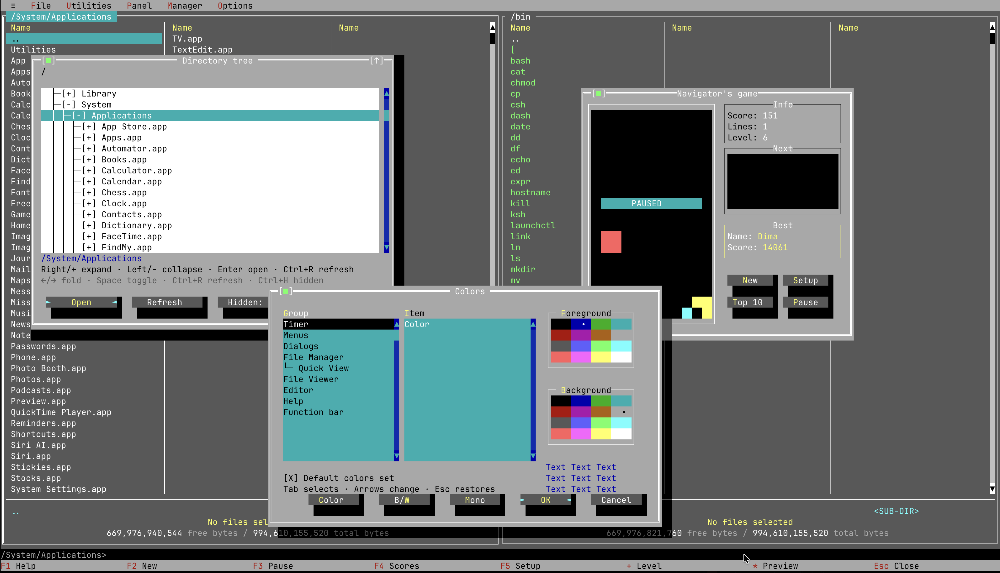
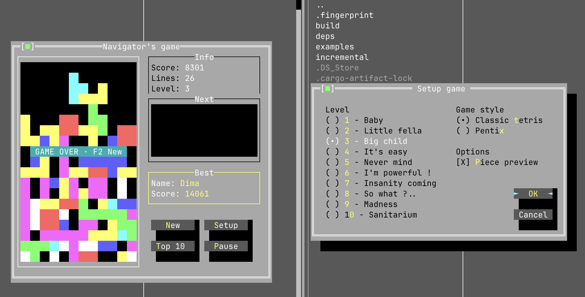

# Directory Navigator

[English](README.md) | [Русский](README.ru.md)

Современный терминальный файловый менеджер на **Rust и Turbo Vision**, вдохновлённый
**DOS Navigator**.

Привычные две панели, классические цвета, сочетания клавиш и управление мышью —
для современных компьютеров. Работает прямо в терминале, без эмулятора DOS
или графической оболочки.

<table>
  <tr>
    <td>
      <a href="docs/images/directory-navigator.png">
        
      </a>
    </td>
  </tr>
</table>

## На основе Turbo Vision

[Turbo Vision for Rust](https://github.com/aovestdipaperino/turbo-vision-4-rust)
используется для файловых панелей, меню, диалогов, редактора, просмотрщика,
утилит и Tetris. Рабочий стол и система контролов отвечают за перемещение окон,
выделение, фокус и обработку ввода. Directory Navigator сохраняет классический
облик DN и добавляет поддержку Unicode и современных файловых систем.

## Возможности

- Просмотр двух каталогов рядом, отметка файлов, копирование, перемещение и переименование.
- Создание каталогов и отправка файлов в корзину с подтверждением.
- Поиск файлов, сравнение каталогов, подсчёт размеров папок и закладки.
- Быстрый просмотр текста и шестнадцатеричных данных, редактирование UTF-8, поиск и замена.
- Несколько открытых редакторов и просмотрщиков с переключением через **Alt+0**.
- Просмотр ZIP, TAR и TAR.GZ без распаковки.
- Запуск команд оболочки из командной строки внизу экрана.
- Настройка интерфейса, часов и заставки; выбор цветов текста и фона отдельных элементов в стиле DN, с наборами Color, B/W и Mono. Настройки сохраняются при выходе.
- Привязка расширений файлов к встроенным редактору и просмотрщику или внешним командам.
- Сведения о выделении, свободном и общем месте на диске внизу файловых панелей.
- Английский и русский интерфейс, независимая настройка формата даты и 12/24-часового времени.
- История команд с поиском, копирование имён файлов и путей во внутренний буфер обмена.
- Калькулятор, таблица символов и настраиваемое пользовательское меню, а также Tetris и Pentix с отдельными сохраняемыми таблицами рекордов.
- Прототип плагина **MP3 Player** в стиле DN с компактным и развёрнутым окном. По умолчанию выключен; включается через Options → Configuration → Plugins. Пока реализован только интерфейс, без воспроизведения звука. Основан на DOS Navigator от RIT Research Labs.

## Как это выглядит

<p align="center">
  <a href="docs/images/overlapping-windows-and-colors.png">
    
  </a>
  <br><strong>Классический рабочий стол DN</strong><br>Перемещаемые окна, дерево каталогов и настройка цветов.
</p>

<table>
  <tr>
    <td align="center" width="50%" valign="top">
      <a href="docs/images/tetris-and-pentix-settings.png">
        
      </a>
      <br><strong>Tetris и Pentix</strong><br>Десять уровней, показ следующей фигуры и отдельные таблицы рекордов.
    </td>
    <td align="center" width="50%" valign="top">
      <a href="docs/images/options.png">
        
      </a>
      <br><strong>Настройте под себя</strong><br>Сочетания клавиш, внешний вид и региональные форматы.
    </td>
  </tr>
  <tr>
    <td align="center" width="50%" valign="top">
      <a href="docs/images/editor.png">
        
      </a>
      <br><strong>Встроенный редактор</strong><br>Редактируйте UTF-8, не выходя из терминала.
    </td>
    <td align="center" width="50%" valign="top">
      <a href="docs/images/make-directory.png">
        
      </a>
      <br><strong>Повседневная работа с файлами</strong><br>Создавайте папки через компактные привычные диалоги.
    </td>
  </tr>
</table>

## Начало работы

### Запуск готового файла

В macOS или Linux откройте терминал в папке с подходящим для вашей платформы `dn`:

```sh
chmod +x dn
./dn
```

Проверить версию можно командой `dn --version` или `dn -V`.

Программа открывает текущий каталог. Размер терминала должен быть не меньше
**80 столбцов × 25 строк**. Текущая сборка для macOS рассчитана на **Apple Silicon**,
не подписана сертификатом Developer ID и не нотарифицирована, поэтому macOS
может блокировать скачанный файл. Для запуска готовых тестовых сборок Rust не нужен.

### Сборка из исходников

Установите стабильный набор инструментов Rust и выполните:

```sh
cargo build --release
./target/release/dn
```

В Windows исполняемый файл находится в `target\release\dn.exe`.

| Платформа | Текущий статус |
| --- | --- |
| macOS Apple Silicon | Основная платформа разработки и тестирования |
| Linux x86_64 / ARM64 | Поддержка предусмотрена; проверка работы на платформе ещё не завершена |
| Windows 10/11 | Поддержка по мере возможности; проверка работы на платформе ещё не завершена |

## Основное управление

При первом запуске открывается приветственное окно с подсказками по клавиатуре,
справкой и настройками клавиш. Его можно открыть снова через **≡ → Welcome…**.
При наличии сохранённых настроек оно автоматически не появляется.

**Классические сочетания DN используются по умолчанию на всех платформах**, включая
macOS. В **Options → Configuration → Keyboard shortcuts** можно выбрать Classic DN,
Mac-friendly или Automatic. Выбранный профиль сохраняется.

В профиле Mac-friendly нажмите **Ctrl+O**, отпустите клавиши, затем нажмите цифру
или букву. Появится подсказка: **5** — копирование, **4** — редактор, **0** — выход.
**Ctrl+O, K** открывает настройки клавиатуры. Классические клавиши также работают;
`^O5` означает Ctrl+O, затем 5. Необязательный профиль Automatic выбирает
Mac-friendly в macOS и Classic DN на остальных платформах.

| Клавиша | Действие |
| --- | --- |
| Tab | Переключение панелей |
| Стрелки / Page Up / Page Down | Перемещение по списку файлов |
| Enter / Backspace | Открыть выбранный элемент / перейти в родительский каталог |
| Insert / Space | Поставить или снять отметку |
| F1 | Справка |
| F2 | Пользовательское меню |
| F3 / F4 | Просмотр / редактирование |
| F5 / F6 | Копирование / перемещение или переименование |
| Ctrl+O | Показать вывод терминала; Ctrl+O/Esc/Enter возвращает в DN (Mac: Ctrl+O дважды) |
| F7 / F8 | Создать каталог / отправить в корзину или удалить с подтверждением |
| F9 / F10 | Меню / выход |
| Ctrl+F7 / Alt+F7 | Рекурсивный поиск / быстрый поиск по имени |
| Ctrl+Q / Ctrl+T | Быстрый просмотр / дерево каталогов |
| Alt+0 | Переключение между файловыми панелями и открытыми документами |

Один щелчок выбирает элемент, двойной открывает его, Ctrl+щелчок ставит отметку.
В просмотрщике и редакторе F1 показывает справку по текущему окну. В macOS для
функциональных клавиш может потребоваться Fn.

**Manager → Windows…** (Alt+0) переключает между файловыми панелями, редакторами
и просмотрщиками. В профиле Mac-friendly также работает **Ctrl+O, затем U**.
Каждый документ сохраняет собственные изменения, историю отмены, поиск и положение
прокрутки. F4 открывает выбранный файл; повторное открытие активирует уже существующий
документ. Закрытие и выход проверяют несохранённые изменения в соответствующих
редакторах. Редакторы и просмотрщики открываются развёрнутыми; окна можно перемещать,
менять их размер и располагать плиткой (**Tile**) или каскадом (**Cascade**) через
меню Manager или список окон. Геометрия окон сохраняется в пределах сеанса.

Копирование и перемещение используют переключаемое окно **Transfer Center**:
можно продолжать просмотр каталогов и редактирование, пока одна операция выполняется,
а остальные ждут в очереди. **Manager → Transfers…** снова открывает ход выполнения
и результаты. Закрытие окна не останавливает работу; ошибка или отмена приостанавливает
очередь до её возобновления. Существующие файлы назначения не перезаписываются.

Нижняя строка — командная. Введите команду и нажмите **Enter**, чтобы выполнить её
в каталоге активной панели; **Esc** очищает строку. **Ctrl+E / Ctrl+X** вызывают
историю команд. `cd "folder name"` меняет каталог активной панели. Если строка пуста,
Enter открывает выбранный элемент. Команды оболочки выполняются с вашими обычными
правами, независимо от подтверждений файловых операций самого менеджера.

## Настройки и работа с файлами

Настройки загружаются автоматически и сохраняются при штатном выходе.
**Options → Save desktop** сохраняет их сразу; **Options → Configuration → System Setup**
управляет сохранением при выходе.

- macOS/Linux: `~/.config/dn/config.conf` или `$XDG_CONFIG_HOME/dn/config.conf`.
- Windows: `%APPDATA%\Directory Navigator\config.conf`.

**Options → Configuration → Language / date & time** меняет язык интерфейса,
порядок даты (год/месяц/день, день/месяц/год или месяц/день/год), разделитель даты
и 12/24-часовой формат времени с настраиваемым разделителем. Apply принимает
изменения, Cancel оставляет прежние настройки. Часы, даты в панелях и сведения
о файлах используют эти параметры. По умолчанию выбраны английский язык,
год-месяц-день и 24-часовое время. Английский и русский каталоги переводов встроены
в программу, отдельные файлы для них не нужны. Непереведённые сообщения выводятся
на английском, а системные ошибки сохраняют исходный текст.

`config.conf` использует TOML с `config_version = 2` и разделами настроек.
Поддерживается только этот формат; старые плоские файлы не преобразуются.
Некорректный файл переименовывается в `_old_config.conf` (с номером, если имя занято),
после чего загружаются значения по умолчанию. При обычном сохранении создаётся новая
конфигурация; недоступные файлы, файлы только для чтения и ошибки восстановления
по-прежнему вызывают сообщения об ошибках. Неизвестные параметры TOML сохраняются.
Автоматически загружается только `config.conf`; `config.txt` игнорируется.

**Options → Import DOS settings…** читает оригинальный `DN.CFG` и показывает
поддерживаемые настройки часов, скрытых файлов, сортировки, подсветки, выделения,
редактора и заставки. Apply применяет их к текущему сеансу; обычное сохранение
записывает их на диск. Cancel ничего не меняет, исходный DOS-файл не изменяется.
DOS-пути, окна рабочего стола, команды, аппаратные настройки и пользовательские
палитры не импортируются; защита корзины и подтверждения сохраняются.
Совместимость проверена на тестовых данных, полученных из исходников;
реальный пользовательский `DN.CFG` пока не проверялся.

По умолчанию файловые операции отказываются работать с уже существующими
назначениями. При копировании можно явно выбрать пропуск конфликтов без
перезаписи. Удаление по умолчанию отправляет файлы в корзину; ошибка корзины
никогда не приводит к автоматическому безвозвратному удалению. Безвозвратное
удаление можно выбрать в File Manager Setup; подтверждение всё равно требуется.
Обнаруженные изменения поставленных в очередь элементов или их родительских
каталогов останавливают операцию. Отмена или ошибка оставляет уже выполненную
работу; автоматического отката многофайловых операций нет.

Это **бета-версия**. Архивы доступны только для чтения; просмотрщик показывает
данные в пределах установленного лимита, редактор поддерживает UTF-8-файлы до
2 МиБ / 100 000 строк. Важные сценарии проверяйте на копиях. В сообщении о проблеме
указывайте ОС, терминал и шаги воспроизведения.

Подробные сочетания клавиш, ограничения и настройка пользовательского меню описаны
в [руководстве пользователя](docs/USER_GUIDE.md) (на английском).

### Tetris, Pentix и оригинальные рекорды

Чтобы импортировать таблицы рекордов DOS Navigator, поместите **`dn.tet`**
(или `DN.TET`) рядом с `config.conf`, затем откройте или переоткройте игру.
Обе оригинальные таблицы объединятся с соответствующими Top Ten в `tetris.conf`
без повторного импорта. Исходный файл останется нетронутым. Режим Classic Tetris
или Pentix выбирается в Setup; Pentix использует все 27 оригинальных фигур
из одной–пяти клеток.

DOS-файлы не содержат сведений о кодировке: при первом импорте используется CP437
для английского или CP866 для русского, в зависимости от языка интерфейса.
Выбор запоминается в файле Tetris. Новые рекорды поддерживают имена в Unicode;
если в оригинальной записи нет числа строк, показывается «—».

## Разработка

Подробности реализации — в [документации об основах работы с документами](docs/DOCUMENT_FOUNDATIONS.md)
(на английском).

```sh
cargo fmt --check
cargo clippy -- -D warnings
cargo test
cargo build --release
```

В GitHub откройте **Actions → Build all platforms → Run workflow**, чтобы проверить
и собрать macOS (Apple Silicon и Intel), Linux (x86_64 и ARM64) и Windows (x86_64).
Каждое успешно завершённое задание загружает архив с исполняемым файлом, README
и лицензией MIT, а также контрольную сумму SHA-256. Файлы находятся в разделе
**Artifacts** этого запуска и хранятся 30 дней. Сборки не подписаны; этот процесс
не публикует GitHub Release. **Rust checks** также запускается только вручную:
откройте его в Actions и выберите **Run workflow**. Оба процесса не запускаются
при push, pull request или по расписанию.

### Общий выпуск для всех платформ

После отправки workflow в основную ветку откройте **Actions → Build unified release
→ Run workflow**, выберите исходную ветку и укажите версию **без `v`**, например
`1.0.0` или `1.1.0-beta.1`.

Ручной процесс проверяет, тестирует и собирает все пять целей: macOS Apple Silicon
и Intel, Windows x86_64, Linux x86_64 и ARM64. Версия встраивается в приложение,
окно About и CLI, затем создаётся **неопубликованный черновик релиза** с тегом
`v<version>`. Предварительные версии отмечаются автоматически.

Для скачивания создаются пять архивов с версией в имени: четыре TAR.GZ и ZIP
для Windows. Каждый содержит исполняемый файл, README, руководство пользователя
и лицензию MIT. Файлы контрольных сумм используются для внутренней проверки
сборок и не прикрепляются к релизу. Имена Linux-архивов:
`dn-<version>-linux-x86_64.tar.gz` и `dn-<version>-linux-aarch64.tar.gz`.

Тег указывает на точное дерево исходников с версией, использованное для всех
сборок. При необходимости отдельный коммит релиза обновляет Cargo.toml/Cargo.lock;
ветка разработки не переписывается, её версия не меняется. Следующую версию ветки
при необходимости задавайте отдельно. Только финальное задание получает право
записи в репозиторий; тег и черновик не создаются, пока не пройдут все пять сборок.
Существующие теги и релизы не перезаписываются. Если публикация завершилась ошибкой
после создания тега или черновика, проверьте эту версию в GitHub: завершите черновик
вручную либо осознанно удалите частичный черновик/тег перед новым запуском.
При восстановлении процесс не удаляет и не заменяет существующие релизы.

Проверьте черновик, скачанные сборки и примечания к выпуску, затем опубликуйте
релиз самостоятельно. Сборки macOS остаются неподписанными и ненотарифицированными;
сборки Windows также не подписаны. Репозиторий должен разрешать Actions запись
содержимого и создание тегов; строгие правила тегов могут блокировать финальное
задание. Все процессы запускаются только вручную, а не при push или создании тега.

### Отдельные сборки Windows и Linux

Эти процессы независимы от общего выпуска и работают только при выборе
**Run workflow**. Выберите исходную ветку и укажите версию без `v`.

| Процесс в Actions | Цели | Файлы в разделе Artifacts запуска |
| --- | --- | --- |
| **Build Windows** | Windows x86_64 | **windows-downloads**: ZIP с `dn.exe` |
| **Build Linux** | Linux x86_64 и ARM64 | **linux-downloads**: два архива TAR.GZ с `dn` |

Оба процесса проверяют, тестируют и собирают приложение, сверяют версию
исполняемого файла и включают README, руководство пользователя, лицензию MIT,
отдельные контрольные суммы SHA-256 и `SHA256SUMS.txt`. Файлы хранятся 30 дней.
Теги, GitHub Releases и черновики не создаются. Указанная версия встраивается
в исполняемые файлы; исходная ветка не меняется. Сборки Windows не подписаны.
Успешная сборка не заменяет проверку в Windows Terminal или терминале Linux.

Тесты вспомогательных скриптов выпуска (Python 3.12+, только стандартная библиотека):

```sh
python3 -m unittest discover -s scripts -p 'test_*.py'
```

Исходники приложения на Rust находятся в `src/`, тесты — в `tests/`.

## Лицензия

Directory Navigator распространяется по [лицензии MIT](LICENSE).

Copyright (c) 2026 Dmitry Yarygin.
